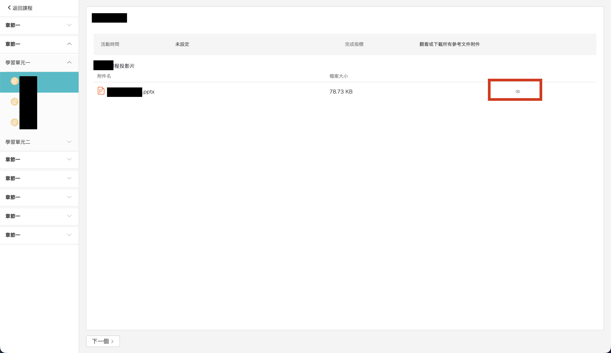
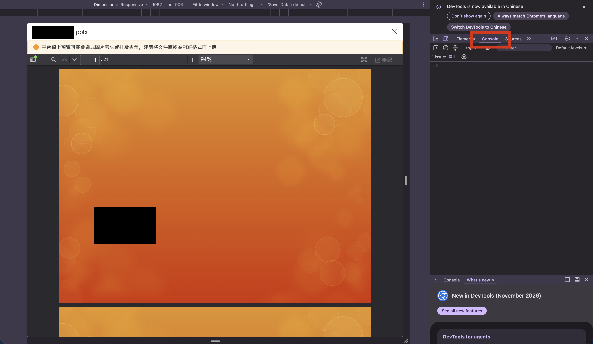
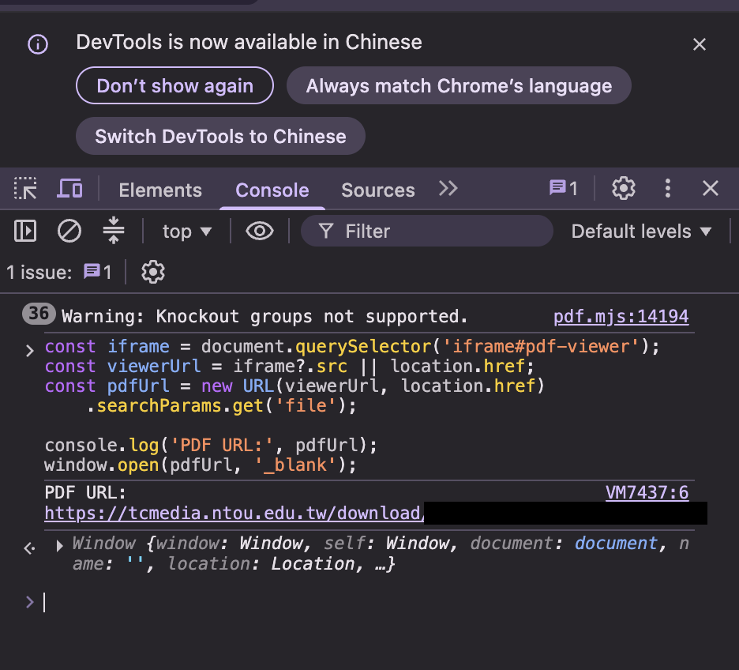

# TronClass PDF Downloader

透過瀏覽器開發者工具，開啟 TronClass 課程中僅可預覽的 PDF，儲存到電腦。

有些課程的 PDF 可以線上閱讀，但沒有顯示「下載」按鈕。協助找出 PDF 預覽器使用的檔案網址。

> [!IMPORTANT]
> 不保證每份 PDF 都能下載。僅限個人學習用途，如果教授明確禁止下載、複製或散布，請遵守規定。

## 使用方式

### 1. 開啟 PDF 預覽

1. 登入 [海洋大學 TronClass](https://tronclass.ntou.edu.tw/)。
2. 進入課程教材。
3. 點開 PDF，確認網頁已正常顯示內容。



### 2. 開啟開發者工具

- **Windows / Linux**：按 `F12` 或 `Ctrl + Shift + J`。
- **macOS**：按 `⌘ Command + ⌥ Option + J`（Chrome）。

切換到 **Console**。



### 3. 執行程式

複製以下程式，貼入 Console，按下 `Enter`：

```javascript
const iframe = document.querySelector('iframe#pdf-viewer');
const viewerUrl = iframe?.src || location.href;
const pdfUrl = new URL(viewerUrl, location.href)
    .searchParams.get('file');

console.log('PDF URL:', pdfUrl);
window.open(pdfUrl, '_blank');
```



如果新分頁順利顯示 PDF，就可以用瀏覽器 PDF 檢視器提供的下載功能或 `Ctrl + S` / `⌘ + S` 儲存。
